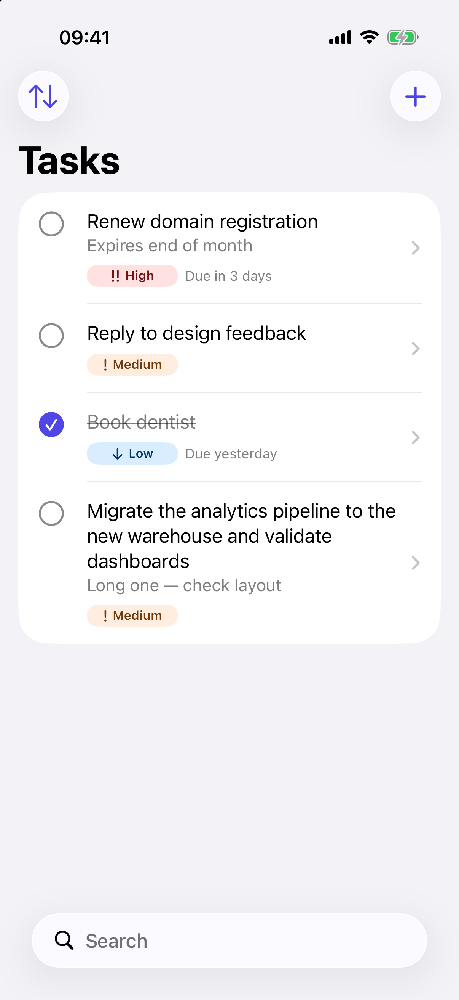
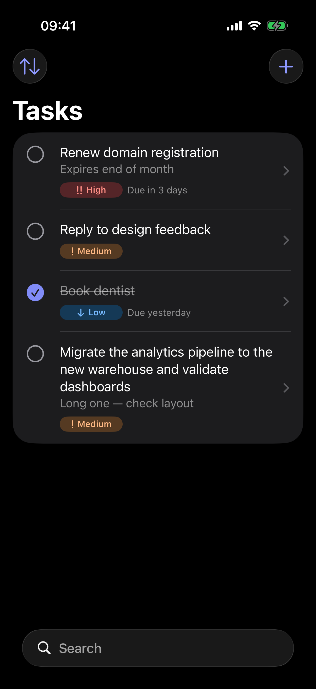
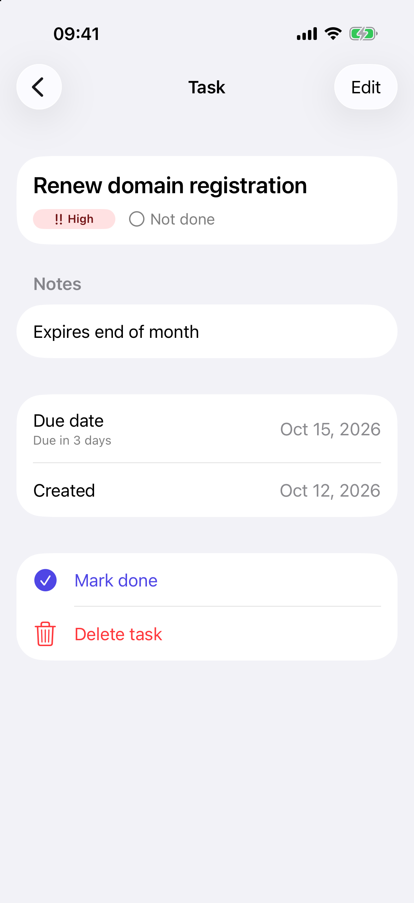
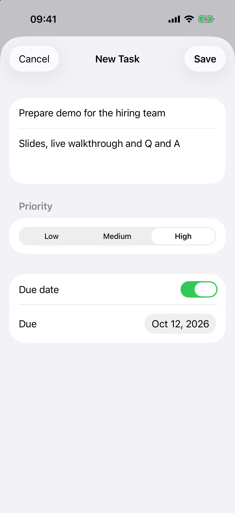
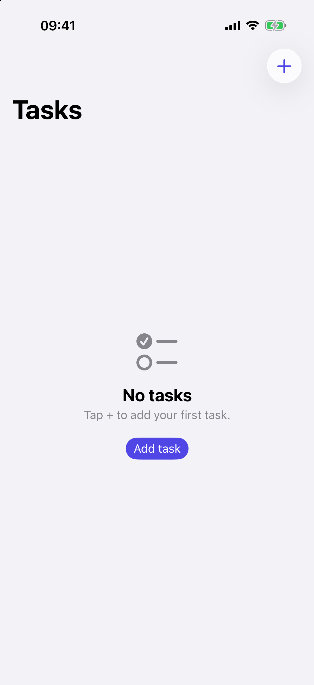
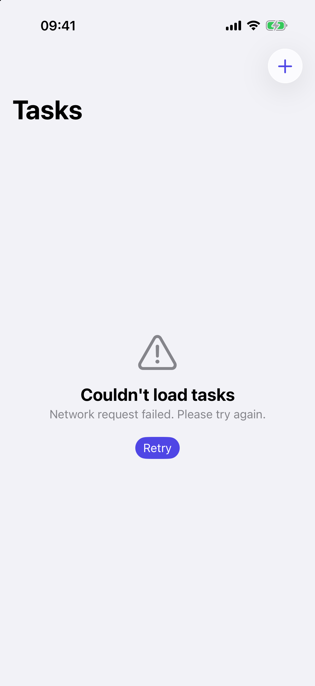
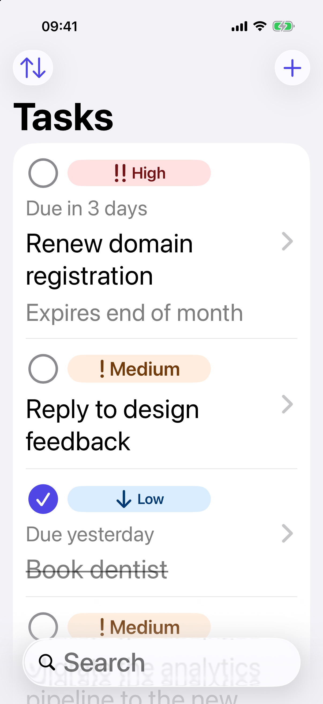

# Task Board

A SwiftUI task manager written for a 45-minute live-coding exercise: a task list with add, toggle, delete and a detail/edit screen, backed by a mock network (300 to 800 ms delay, about 15% failures), with loading, empty and error states and a four-task seed. After the session the app was reviewed and polished; the history below shows what changed.

## Screenshots

<p>
  
  
  
  
</p>
<p>
  
  
  
</p>

## Interview version vs now

The tags `interview-session` and `interview-as-built` both point at commit `950b267`, the app as it stood at the end of the call. Compare with the current state: [interview-session...main](https://github.com/alexslkgit/task-board-ios/compare/interview-session...main).

Added after the call (from the commit messages):

- `7e2391d` Project renamed to TaskBoard (target, scheme, bundle ids). Launch-argument parsing moved out of the App struct into `LaunchConfiguration`.
- `89ff588` Read-only detail screen with Edit, discard confirmation, due dates with relative labels, due-date sort, `SceneStorage` for sort and search, accessibility actions, accent colour, previews, 16 new tests (repository cache, mock API, seed).
- `f846ebc` Fix for undo duplicating a row, hardened form, Swift 6 language mode with strict concurrency, banner fixes, layout at accessibility text sizes, dark-mode badge contrast, empty and no-results states, iPhone only.

## Features

Core spec: list, add, toggle done, delete, detail and edit, mock network with latency and failures, loading, empty and error states, seeded data.

Beyond the spec:

- Search and sort (created, priority, status, due date).
- Swipe to delete with an undo banner.
- Due dates with relative labels.
- Sort order and search text restored through `SceneStorage`.
- Unsaved-changes guard on the form.
- Dark mode.
- Dynamic Type up to the accessibility sizes (rows, detail header and banners reflow).
- VoiceOver custom actions on rows (toggle, delete).

## Architecture

```
Features   TaskListView / TaskDetailView / TaskFormView
              |  observes
           TaskListViewModel  (@Observable, optimistic state, SerialWriteQueue)
              |  async calls
Data       TaskRepository  <-  DefaultTaskRepository (actor, cache + generation counter)
              |
           TaskAPI         <-  MockTaskAPI (actor, latency + random failures)
Model      TaskItem, Priority
```

Layers:

- `Model`: `TaskItem` and its priority.
- `Data`: `TaskAPI` is the remote source of truth, `MockTaskAPI` the only implementation. `TaskRepository` is what the UI depends on; `DefaultTaskRepository` adds an in-memory cache.
- `Features`: `TaskList`, `TaskDetail`, `TaskForm`, plus `Shared` (banner, presentation helpers, preview data). `TaskListViewModel` is the single `@Observable` owner of list state.
- `App`: `TaskBoardApp` and `LaunchConfiguration`.

Key decisions:

- **Default MainActor isolation and Swift 6 strict concurrency.** UI state needs no manual hopping, and data races are compile errors. Data types are explicitly `nonisolated` and `Sendable`.
- **Optimistic updates with rollback to the last server-confirmed value.** The UI reacts immediately. On failure a row returns to what the server last accepted, not to whatever the previous local edit was.
- **Per-task serialized writes (`SerialWriteQueue`).** Two quick toggles on one task run in submission order, so a late failure cannot roll back over a newer success. Different tasks still run in parallel.
- **Refresh merge keeps rows touched since the fetch started.** A pull to refresh that was slower than a local edit does not overwrite it. The repository also uses a generation counter so a stale fetch cannot replace the cache after a write.
- **Idempotent create (upsert by id).** If undo fires while the delete is still failing in flight, the row is replaced, not duplicated.
- **Error surfacing.** Failures of list actions show a banner that owns its timer; the form shows its own error inline, next to the data the user is editing.
- **In-memory only.** The spec asked for a mock network; persistence was out of scope.

## Running

Requirements: Xcode 27 (built and tested with 27.0, build 27A266a; the project uses `objectVersion` 90 and synchronized folders), iOS 18.0 deployment target, Swift 6 language mode.

1. Open `TaskBoard.xcodeproj`.
2. Pick the `TaskBoard` scheme and an iPhone simulator.
3. Run.

Launch arguments reproduce hard-to-hit states. Set them in Product > Scheme > Edit Scheme > Run > Arguments > Arguments Passed On Launch, or pass them to `xcrun simctl launch`.

| Argument | Effect |
|---|---|
| `-mockFailureRate 1` | Failure probability for every call, 0 to 1. Default 0.15. |
| `-mockWriteFailureRate 1` | Overrides the failure probability for create, update and delete only. Defaults to the value above. |
| `-mockEmpty YES` | Starts with no tasks instead of the four-task seed. |
| `-mockLatency 3` | Fixed delay in seconds for every call. Default is 0.3 to 0.8 s for fetch and 0.1 to 0.3 s for writes. |

An explicit `0` is honoured and is not treated as a missing argument.

## Tests

Swift Testing, 50 `@Test` functions in 8 suites; the last run reported `Test run with 50 tests in 8 suites passed`.

| Suite | Covers |
|---|---|
| `TaskListViewModelTests` | optimistic updates, rollback, undo, refresh merge, sorting, banners |
| `WriteSerializationTests` | ordering of writes per task, parallelism across tasks |
| `EdgeCaseTests` | races between delete, undo, update and refresh |
| `DefaultTaskRepositoryTests` | cache hits, forced refresh, generation counter, upsert |
| `MockTaskAPITests` | CRUD, failure rate, not-found errors |
| `SeedTests` | seed content and ordering |
| `TaskItemTests` | edit merge keeps untouched fields, single-line title normalisation |
| `LaunchConfigurationTests` | defaults, parsing, explicit zero |

Run from the command line:

```
xcodebuild test -project TaskBoard.xcodeproj -scheme TaskBoard \
  -destination "platform=iOS Simulator,name=iPhone 17 Pro"
```

The suite also passes with Thread Sanitizer (`-enableThreadSanitizer YES`), with no reports.

## Known limitations and next steps

- Data lives in memory only; it resets on every launch.
- No UI tests; coverage is at the view model, repository and API level.
- No string catalog yet. User-facing strings already go through `String(localized:)` or `LocalizedStringKey`, so adding one is mechanical.
- iPhone only (`TARGETED_DEVICE_FAMILY = 1`), single scene.

## Logging

`os.Logger` with the app bundle id as subsystem (`com.alexslk.TaskBoard`) and four categories:

| Category | Source |
|---|---|
| `network` | mock API calls, simulated latency, injected failures, launch configuration |
| `repository` | cache hits and misses, fetch and write results |
| `tasks` | view model actions: rollback, undo, merge |
| `ui` | view-level events |

In Console.app, filter with `subsystem:com.alexslk.TaskBoard` (add `category:network` to narrow it). From a terminal:

```
xcrun simctl spawn booted log stream --level debug --predicate 'subsystem == "com.alexslk.TaskBoard"'
```
